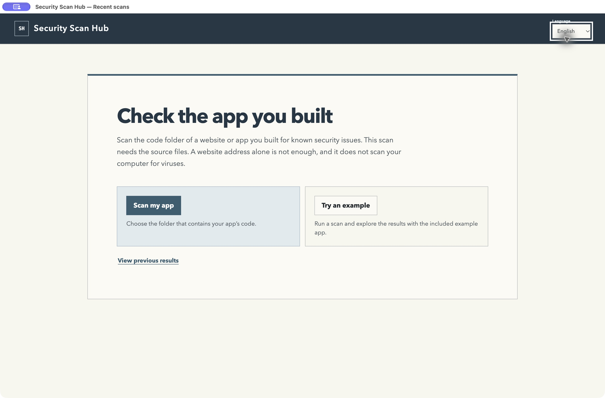
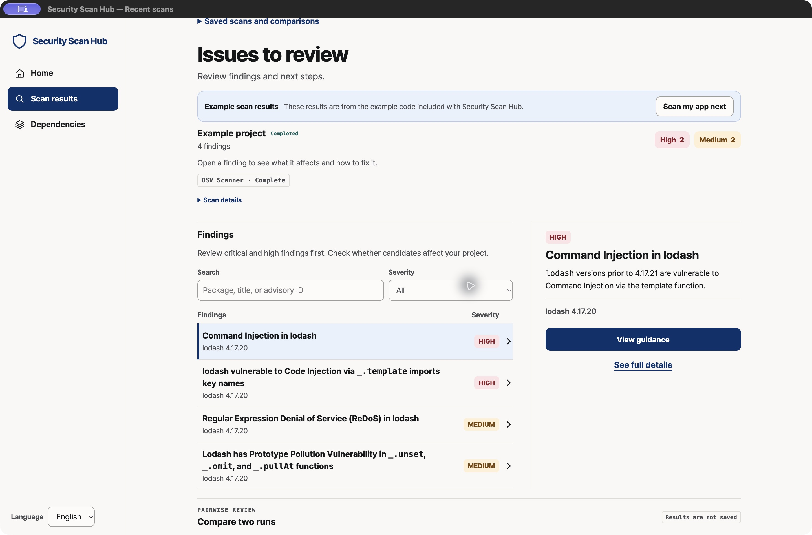
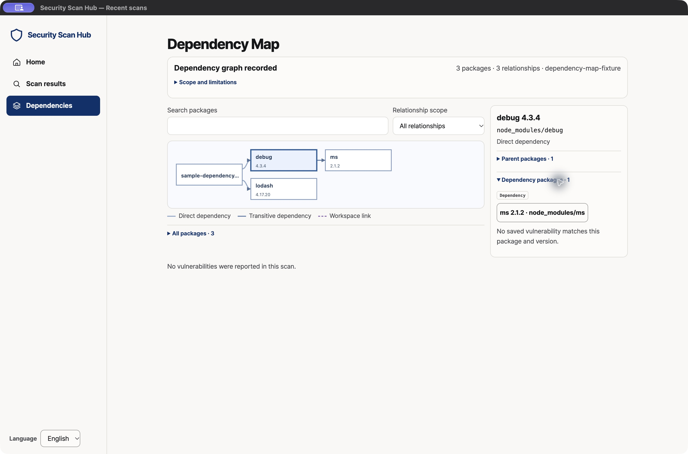

# Security Scan Hub

**Seven security tools. One place to review the results.**

Security Scan Hub is a desktop app that brings together dependency checks,
code reviews, and AI security scans. Scan a project's source folder, see which
checks ran, and review findings and recommended next steps in one place.
Reports are also available as HTML, JSON, and SARIF.



## Seven integrations

| Tool | What it does |
| --- | --- |
| [Google OSV Scanner](https://github.com/google/osv-scanner) | Finds known vulnerabilities in project dependencies. |
| [NVIDIA SkillSpector](https://github.com/NVIDIA/SkillSpector) | Checks AI agent skills for suspicious patterns. |
| [OpenAI Codex Security](https://github.com/openai/codex-security) | Reviews source code for potential vulnerabilities. |
| [Alibaba Open Code Review](https://github.com/alibaba/open-code-review) | Reviews code for security and correctness issues. |
| [OpenAI PHP2Shell Checker](https://github.com/openai/php2shell-checker) | Checks a supplied URL's headers for signs of affected PHP versions. |
| [Cloudflare Security Audit Skill](https://github.com/cloudflare/security-audit-skill) | Runs a security audit workflow through Codex CLI. |
| [Anthropic Defending Code Reference Harness](https://github.com/anthropics/defending-code-reference-harness) | Runs Claude Code's `/vuln-scan` skill in static mode. |

OSV Scanner is included for a first scan. Other tools need separate setup;
some require sign-in. AI scans are opt-in and may send code or context to their
providers. Windows supports up to five integrations: the Cloudflare and
Anthropic workflows are disabled. See [tool setup](desktop/README.md#run-a-multi-tool-scan).

## Install

**Mac** — download the signed and notarized 0.2.9 prerelease for your Mac,
extract the ZIP, and open **Security Scan Hub.app**:

- [Apple silicon (M-series)](https://github.com/taejunoh/security-scan-hub/releases/download/desktop-v0.2.9/sec-hub-desktop-0.2.9-darwin-arm64-notarized-prerelease.zip)
- [Intel](https://github.com/taejunoh/security-scan-hub/releases/download/desktop-v0.2.9/sec-hub-desktop-0.2.9-darwin-x64-notarized-prerelease.zip) — requires macOS 13 or later

If you use [Homebrew](https://brew.sh/), you can install either Mac version
from Terminal instead:

```sh
brew install --cask taejunoh/tap/security-scan-hub
```

To update later, run `brew upgrade --cask security-scan-hub`.

**Windows** — [install from Microsoft Store](https://apps.microsoft.com/detail/9NQQRS8WX1T7)
or [download the 0.2.8 portable prerelease](https://github.com/taejunoh/security-scan-hub/releases/download/desktop-v0.2.8/sec-hub-desktop-0.2.8-win32-x64-prerelease.zip).
For the portable version, extract the ZIP and open **Sec Hub.exe**; keep the
files together. It is unsigned, so Windows may show an unknown publisher warning.
The Store and portable releases are versioned separately.

[Full installation guide](docs/GETTING-STARTED.md) ·
[Mac release and checksums](https://github.com/taejunoh/security-scan-hub/releases/tag/desktop-v0.2.9) ·
[Windows release and checksums](https://github.com/taejunoh/security-scan-hub/releases/tag/desktop-v0.2.8)

## Run your first scan

1. Choose **Try an example**, then **Start example scan** to explore the app
   with its included sample. This does not scan your own project.
2. To scan your project, choose **Scan my app** and select the folder containing
   its source code and package files. If it is a ZIP, extract it first.
3. Start the scan, then review the findings and **What to do next**. Choose
   **View previous results** to reopen a saved report.

To run multiple configured tools together, see [Run a multi-tool scan](desktop/README.md#run-a-multi-tool-scan).

## Review results



The **Security Inbox** groups findings in one place. Search or filter the list,
open an item to inspect its evidence, and check its recommended action. The
example above shows saved OSV results for the included sample, not your project.

A completed scan with no findings means the selected tools reported no issues
in the scope they checked; it is not a guarantee that the project is secure.

### Dependency Map



Open **Dependencies** after a scan to explore package relationships and any
matching saved findings. The map currently supports project-root npm
`package-lock.json` and `npm-shrinkwrap.json` files in lockfile versions 2 or
3. It represents the recorded lockfile, not the live installed state; missing
or unsupported data is reported as partial or unavailable.

## Requirements and limitations

- OSV Scanner needs internet access and may send package names and versions
  to advisory and package metadata services. PHP2Shell checks the supplied URL.
- Additional tools may require installation, configuration, and provider
  authentication. SkillSpector needs a target with a top-level `SKILL.md`.
- Upstream updates can change commands, authentication, or report formats.
  Check the [verified versions](src/adapters/SOURCES.md) and
  [Cloudflare and Anthropic requirements](docs/REFERENCE.md#official-security-skill-workflows)
  before upgrading an integration.
- The notarized Intel ZIP passed smoke testing on a hosted Intel Mac; it was
  not tested on a physical user's Mac. The Store's OSV scan and reports were
  tested on Windows 11 ARM in a virtual machine using x64 emulation; that check
  did not cover every integration or native Intel/AMD hardware.

## More information

- [Desktop setup and multi-tool scans](desktop/README.md)
- [CLI setup and technical reference](docs/REFERENCE.md)
- [Sample multi-tool report](docs/sample-report.html)
- [Release and verification history](docs/HISTORY.md)
