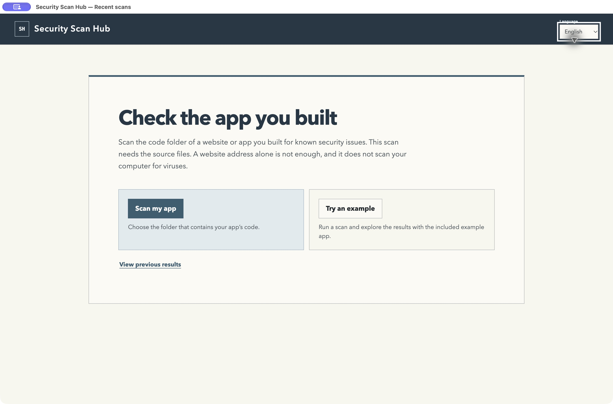
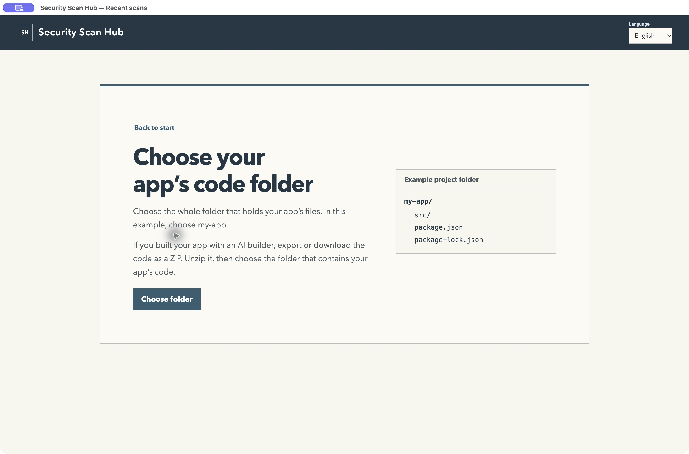

# Your first scan — 0.2.6

This guide describes the 0.2.6 desktop prerelease. The current Microsoft Store
version has the older first screen. See the [installation guide](GETTING-STARTED.md)
for downloads and current Store availability.

## What does the app check?

Security Scan Hub checks the **source code of a website or app**. Its basic
scan looks for known security problems in the packages that project uses.
It is not an antivirus scan of your computer. You do not need to understand
code to try it, but checking your own app requires its source-code folder.

## No code folder? Try the example

1. Open **Security Scan Hub** and choose **Try an example**.
2. Read the short explanation, then choose **Start example scan**.
3. Wait for the report to open. Choose a finding and read **What to do next**.

This runs the included OSV Scanner on a small bundled example. It does not
install or run the example's code. No login or AI subscription is required.
An internet connection is needed: package names and versions are sent to
OSV's lookup services. The report is marked as an example; it says nothing
about your own app or computer.

When you are ready, choose **Scan my app next**.

## Have your app's code? Select that folder

1. Choose **Scan my app**.
2. Choose **Choose folder**, then select the folder containing the files used
   to build your website or app. For example, select `my-website`, which may
   contain `src`, `package.json`, and `package-lock.json`.
3. Read the folder check. Recognized package files are shown when found.
4. Choose **Start basic scan**. The report opens when the scan finishes.

If you downloaded a ZIP of the source code, extract it first and select the
extracted project folder. Do not select the Security Scan Hub application,
your whole Documents folder, or a folder containing only photos and PDFs.
A website address alone is not a code folder. If someone else built your app,
ask them for its source-code folder or repository download.

The folder hint is a quick filename check, not proof that every file is
supported. If it finds no recognizable package files, choose another folder
or try the example. Advanced users can still use their configured tools.

## What should I do with the results?

Open the highest-severity findings first. **What to do next** explains what to
check and any fix supported by the scanner's evidence. Share the report with
your developer if you do not maintain the code yourself. Findings need review;
an empty report does not prove the app is safe.

Use **View previous results** to reopen saved reports. Additional tools and
their setup instructions are available through the advanced controls. The
basic scan needs no additional setup.

[Validation record and platform limits](FIRST-SCAN-VALIDATION.md)
