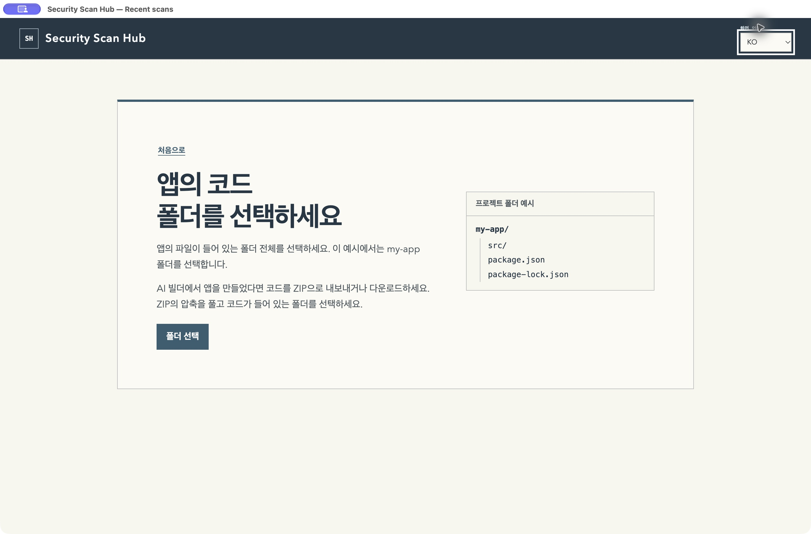
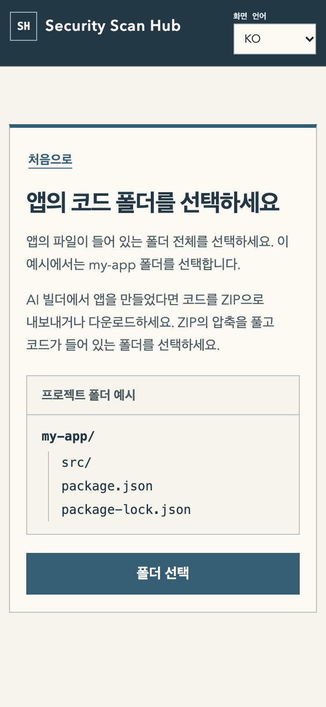

# First-scan onboarding validation — 2026-11-11

Security Scan Hub Desktop **0.2.6** is published as a GitHub prerelease.
The Microsoft Store currently lists 0.2.4; its 0.2.5 update is in publishing.
A Microsoft Store submission for 0.2.6 is not confirmed.
[Download the 0.2.6 release assets](https://github.com/taejunoh/security-scan-hub/releases/tag/desktop-v0.2.6).

## Behavior verified

- The first screen explains the purpose and offers **Scan my app** and
  **Try an example**, without scanner selection or synthetic history.
- The folder guide shows a concrete folder tree and explains ZIP extraction.
  A bounded filename check recognizes package files, avoids directory symlinks,
  and gives an advisory fallback for unrecognized layouts.
- The example performs a real bundled OSV scan with no login, AI call,
  dependency installation, or execution of target code. Only the bundled
  scanner can run in this mode; staged example tampering is rejected.
- Example provenance survives saved JSON, the app, the browser, standalone
  HTML, and SARIF. A real user-folder scan is not labeled as an example.
- A cold restart followed by **View previous results** reloads persisted reports.
- macOS Finder/app/helper names and icon are consistent. Historical user data
  and bundle identifiers are retained. Windows window/Store icon assets are
  updated without rewriting the upstream Electron PE executable.

## Automated checks

| Check | Result |
| --- | --- |
| Full core suite, with its pinned Cloudflare fixture configured | 633 tests: 622 passed, 11 skipped, 0 failed |
| Final affected desktop/dashboard/report suites after review fixes | 160 passed, 0 failed |
| Final Apple silicon packaged smoke | All 10 gates passed |
| Fresh archive extraction on both Mac architectures | Strict codesign verification passed |
| Packaged source comparison | All 58 app/core files matched the final source byte-for-byte |
| Independent code review | Both identified defects fixed and rechecked; no remaining blocking finding |

The full core run began before the last history/export review fixes. The final
160-test run covers those changed components; these counts overlap and must not
be added together. The skipped tests are not represented as passes.

## Actual screen and execution checks

The x64 Mac app ran under **Rosetta on Apple silicon**, not on physical Intel
hardware. Native UI interactions completed both the bundled example and a
separately chosen controlled `my-app` folder. Each actual OSV run reported four
lodash findings (two high, two medium), and the recommendation showed the fixed
version 4.17.21. No vulnerable code was run. After quitting and reopening the
final package, both saved reports appeared through **View previous results**.

English and Korean first-use and folder guidance screens were inspected in the
native app. A 360px Chrome rendering check, using a controlled desktop bridge
fixture, confirmed no horizontal overflow or Korean words split mid-word. A
browser-only report check confirmed the example label remains visible without
a desktop action button. The native app retains its 850px minimum window width.

Native folder selection had a transient delay during concurrent validation.
A process sample showed AppKit event waiting, and the same directory inspection
completed in 23ms outside the dialog. Selection later completed. One unfocused
scan click was rejected; raising the window and retrying completed the scan.
No security checks were bypassed and no cause for the dialog delay is claimed.

360px rendering check (controlled bridge fixture)

## Hosted validation of commit 8e22c1d

[Desktop validation run 43090632928](https://github.com/taejunoh/security-scan-hub/actions/runs/43090632928)
completed successfully on hosted macOS x64, macOS arm64, and Windows x64.
Each packaged application passed all ten smoke checks, including first use,
actual bundled OSV demo, a separate folder scan, and report opening.
The macOS x64 runner verifies an Intel execution environment; it is not an
uncoached test on a user's physical Intel Mac.

[MSIX validation run 43090788309](https://github.com/taejunoh/security-scan-hub/actions/runs/43090788309)
installed a disposable test-identity MSIX on Windows x64 and passed all ten
smoke checks. It is not the Microsoft Store-signed release package. A separate Windows 11
ARM64 virtual machine also displayed the portable x64 app under emulation; a
real example scan produced four findings and showed the 4.17.21 recommendation.
The guest's raw report could not be retrieved after its guest agent timed out;
the result was verified on screen. This is not a physical Windows PC test.

Both macOS 0.2.6 ZIPs were signed with Developer ID and notarized by Apple.
The extracted final ZIPs passed signature, stapled ticket, and Gatekeeper
checks. The final arm64 ZIP passed packaged smoke natively on Apple silicon;
the final x64 ZIP also passed packaged smoke under Rosetta on Apple silicon.
The exact notarized x64 ZIP then passed a native packaged smoke on a hosted
Intel Mac in [run 43093795722](https://github.com/taejunoh/security-scan-hub/actions/runs/43093795722).
That hosted runner result does not claim testing on a physical user's Intel Mac.

The Windows x64 package passed hosted install-and-scan checks, and the Windows
11 ARM64 virtual machine displayed the portable x64 app under emulation. These
checks do not establish behavior on a physical Windows PC.

## Release package receipts

| Target | Release ZIP | ZIP SHA-256 |
| --- | --- | --- |
| darwin-arm64 | [sec-hub-desktop-0.2.6-darwin-arm64-notarized-prerelease.zip](https://github.com/taejunoh/security-scan-hub/releases/download/desktop-v0.2.6/sec-hub-desktop-0.2.6-darwin-arm64-notarized-prerelease.zip) | `aa4dc684996d8fad59051bf253159a1a20800d20e01177eb1c6672a14ea87c19` |
| darwin-x64 | [sec-hub-desktop-0.2.6-darwin-x64-notarized-prerelease.zip](https://github.com/taejunoh/security-scan-hub/releases/download/desktop-v0.2.6/sec-hub-desktop-0.2.6-darwin-x64-notarized-prerelease.zip) | `0f847592a0b77bcb5be53c0a09c4ce1d0e55c2e3161746b43112969ff5079091` |

[Windows x64 portable ZIP](https://github.com/taejunoh/security-scan-hub/releases/download/desktop-v0.2.6/sec-hub-desktop-0.2.6-win32-x64-prerelease.zip) · [SHA-256 checksums](https://github.com/taejunoh/security-scan-hub/releases/download/desktop-v0.2.6/sec-hub-desktop-0.2.6-SHA256SUMS.txt)

An uncoached first-time nondeveloper usability test remains separate from this
automated and native walkthrough. The hosted Intel smoke does not substitute
for an uncoached test on a user's physical Mac.
